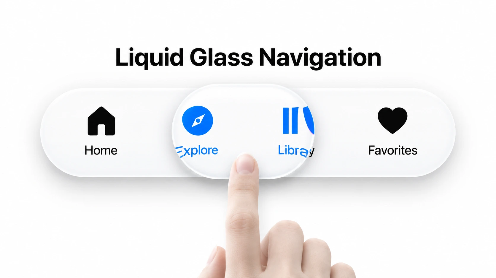
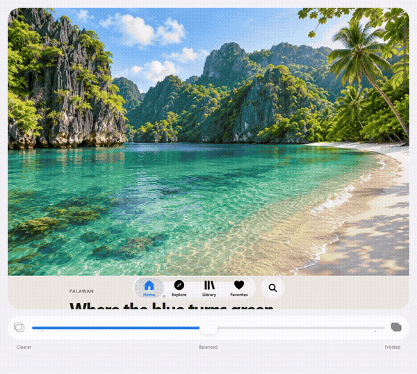

# GlassNav

Liquid Glass navigation built for the web. An independent recreation of the
press, hold, slide, and refractive appearance of Apple's iOS navigation.

[](https://jcdcocampo.pages.dev/projects/liquid-glass)

## Try it live

[Open the interactive playground](https://jcdcocampo.pages.dev/projects/liquid-glass#glass-playground)

The article contains a scrollable Philippine scenery gallery, four playable navigation tabs,
a circular Search button, and a drag-only appearance slider. Dragging is continuous;
releasing near Clearer, Balanced, or Frosted softly snaps to that stop (40%, 60%,
or 80%). Intermediate values remain where you leave them.
Three dots mark those positions. The white slider thumb becomes clear Liquid Glass
while pressed, above a rounded blue progress line that follows the thumb center.
The fill extends to the track edges only on endpoint snaps. Release finishes
with a soft inward squeeze, anchored at an endpoint or symmetric at Balanced
and intermediate positions. Pointer dragging is bound to the visible thumb;
the range input remains available for keyboard controls.

On narrow mobile layouts the scrollable scene is square and fills the article
margins; wider layouts use a 4:3 scene. Its gray scrollbar stays clear of the
rounded corners, shortens gently on overscroll, and springs back. The appearance
slider stays below the scene.

## Video demo

[](https://github.com/jcdocampo/glass-nav/raw/refs/heads/main/assets/demo.mp4)

[Watch or download the full MP4](https://github.com/jcdocampo/glass-nav/raw/refs/heads/main/assets/demo.mp4)

## How it was made

Apple's Materials guidelines and Meet Liquid Glass session informed the floating
navigation layer, legibility, lensing, and interaction feedback. Frame-by-frame
observations of native navigation recordings guided the motion and settling.
JavaScript, CSS, Canvas 2D, and WebGL reproduce those cues in the browser.

Hold duration drives swelling. Filtered pointer velocity drives horizontal
stretching, with controlled recovery, direction changes, and compression at
the ends. The same contour drives the lens silhouette, highlight, shadow,
refraction field, and content mask.

Canvas reconstructs a bounded part of the supported DOM content behind the
controls. A WebGL shader bends that texture along the edges and separates color
channels near contrast boundaries. Cached scene geometry and optional worker
rasterization help keep scroll updates responsive.

## Use it in a web deployment

Copy `src/` into your site's static assets and load `src/glass.css`. Use the
navigation and companion-button markup in `index.html`, then initialize the
controls from your application module.

```js
import {createGlassControls} from './src/index.js'

const controls = await createGlassControls({
  navbar: document.querySelector('.glass-navbar'),
  button: document.querySelector('.glass-action'),
  root: document.querySelector('main'),
  active: 'home',
  frost: .6,
  onSelect: id => navigateTo(id),
  onSearch: () => openSearch(),
})

controls.setFrost(.4)
controls.setFrost(.8)
controls.navbar.select('library')

// Clean up when the controls leave the page.
controls.destroy()
```

Keep the controls outside the sampled content root, or mark them with
`data-glass-control`. Serve the JavaScript modules and images from your static
host. Image sampling requires same-origin assets or appropriate CORS headers.
The demo files can be adapted to your own deployed page.

Mouse, touch, pen, keyboard navigation, and reduced motion are supported. A
simpler Canvas/native-frost fallback handles unavailable WebGL. Background
reconstruction covers supported text, images, and fills. Embedded documents,
video, and complex compositing can differ from the source content.

## Design references

- [Apple Materials guidelines](https://developer.apple.com/design/human-interface-guidelines/materials)
- [Meet Liquid Glass](https://developer.apple.com/videos/play/wwdc2025/219/)
- [Animate with springs](https://developer.apple.com/videos/play/wwdc2023/10158/)

Liquid Glass is Apple's design material. GlassNav is an independent web
implementation and is not affiliated with or endorsed by Apple.

## License

Source code is available under the MIT license. The supplied cover, generated
scenery, and demo media are shared under CC BY-SA 4.0. Attribution and modification details are in
[ASSETS.md](ASSETS.md).
